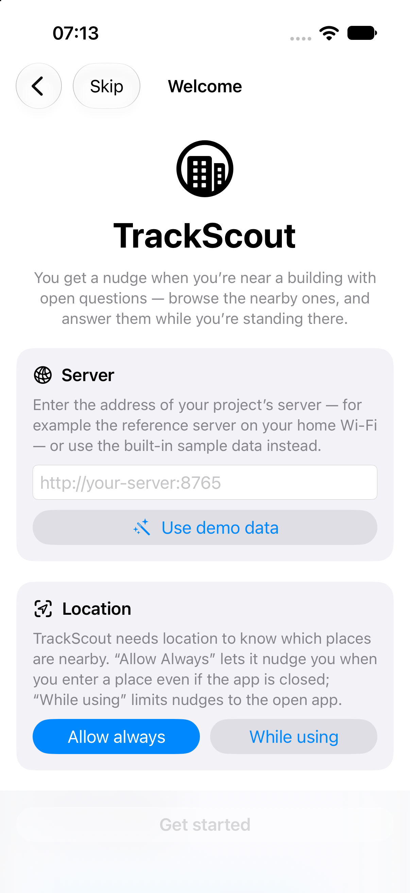
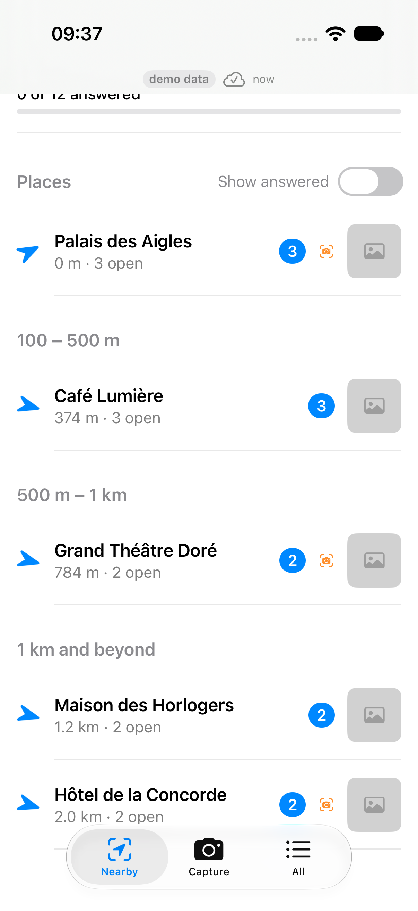
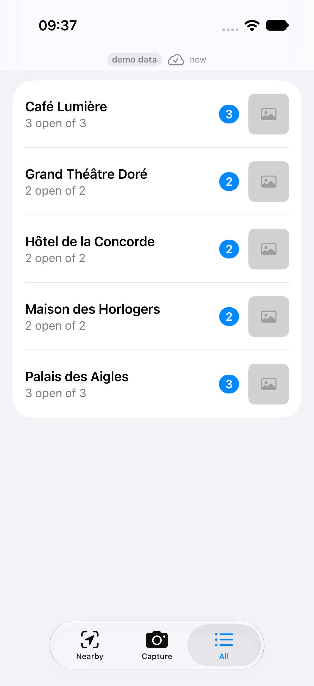
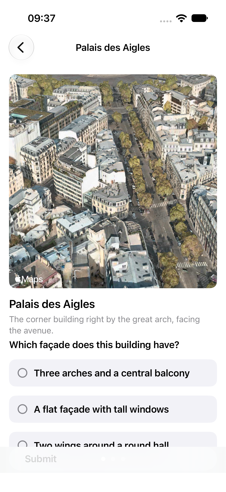
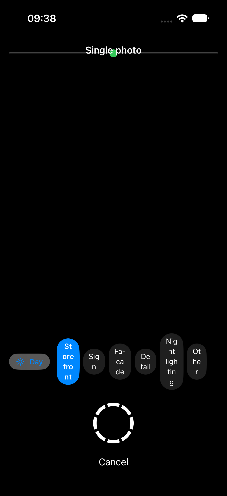

# TrackScout

A field-research app for 3D city building. Your agents turn documents and geodata into
questions; you walk your own track and answer them on the spot, with photos; a small
server on your home network collects everything; your Blender-side agent reads the
merged view and builds the track.

Everything runs on your own machines. The app talks to a one-file Python server over
your home Wi-Fi. No cloud, no account, no third-party service.

The app is three tabs:

- **Nearby** - open questions grouped into distance bands, with a nudge when you get close to a place.
- **Capture** - the camera, for the spots where a question asked for a photo.
- **All** - every place, grouped and searchable.



## How the loop works

```
your research (documents, geodata, street photos)
   |
   v
agents write questions.json               schemas/questions.schema.json
   |
   v
you walk the track: answer + photograph   this app, on your phone
   |
   v
review server on your home LAN            server/trackscout_server.py
   |
   v
agents read answers_merged.json           tools/export_for_agents.py
   |
   v
Blender: georeferenced, measured, lit
   |
   +---- new questions where the answers revealed gaps
```

## Quick start (10 minutes)

You need a Mac with Xcode, an iPhone, and Python 3.9+. The Mac and the iPhone on the
same Wi-Fi.

1. **Start the reference server** with the example data:

   ```
   git clone https://github.com/stormbuster/trackscout
   cd trackscout
   python3 server/trackscout_server.py --questions examples/demo_questions.json --data data
   ```

   It listens on port 8765. Get your Mac's LAN address with `ipconfig getifaddr en0`.
   Or skip the server entirely: the app ships the same example data built in. Tap
   **Use demo data** on first launch and everything works offline, with answers kept
   on the phone.

2. **Build the app for your iPhone.** Open `TrackScout.xcworkspace` in Xcode, choose
   your iPhone as the run destination, then change exactly two values in
   `Config/Shared.xcconfig`: `PRODUCT_BUNDLE_IDENTIFIER` (any identifier you can sign,
   e.g. `com.example.trackscout`) and `DEVELOPMENT_TEAM` (your 10-character team id,
   from Xcode > Settings > Accounts). Run.

3. **First launch on the phone:** allow location (choose *Always* if you want the
   background nudges), then either enter `http://your-server:8765` with `your-server`
   replaced by the address from step 1, or tap **Use demo data**. Get started.

   

4. **Answer and photograph.** Tap a building in Nearby, walk through its pages,
   submit. Where a question says *Photo wanted*, use the Capture tab, pick the
   building, and shoot.

   
   
   

5. **See what you sent.** The server writes everything into the `data` folder:
   `answers.json` (current answer per question), `answers.jsonl` (full history),
   `photos/<date>/*.jpg`. Or fetch `http://your-server:8765/data/owner_answers.json`.

The example data is fictional: 12 questions about 5 invented buildings on a real
street (the Champs-Élysées). The street is real, the buildings are not, and there are
no real answers in the repo. It exists so a fresh clone runs the whole loop with zero
setup.

## Using it with your own track

The questions file is the interface between you and your agents. The schema defines
it, and the validator checks it:

```
python3 tools/validate_questions.py your_questions.json
```

Field rules for the agent that writes your questions:

- **One question per architectural decision.** If two decisions are tangled in one
  question, split it.
- `type` is `yesno` (no options), `choice` (2-5 options), or `text` (no options).
  Use yes/no where the decision actually is binary; the owner answers faster.
- `context` is one short sentence that says which part of the building the question
  is about. The owner stands on a pavement and cannot read your geodata.
- `lat`/`lon` is a point on the pavement facing the subject, not the building
  centroid: the owner walks there, and that is where the app alerts and where the
  photo is stamped.
- `images`: 0-3 reference images. Relative paths (served by the reference server
  from `--root`, defaulting to the questions file's own directory) or full https
  URLs.
- `photo_wanted` is `day`, `night`, or `both`. Set it only where a photo genuinely
  changes the build (facade type, signage, night lighting). Do not set it on every
  question: the owner's camera roll is not a survey instrument.
- **Keep ids stable across regenerations.** Answers and photos attach by `id`;
  rename or renumber one and you orphan its answers and photos. Derive the id from a
  permanent key (building + decision), never from a list position.
- `page`/`order` is the display sequence within a building. `group` is a free-form
  label (the All tab sections by it). `building` is the display name. Several
  questions normally share one building and one point.
- Internal project ids (geodata keys, dossier paths) may sit alongside in the file.
  The app never shows them.

A prompt you can paste to the question-writing agent:

```
Write TrackScout field questions for these buildings. One question per
architectural decision. Each question is a JSON object:
  id        stable, no whitespace, derived from building + decision
  page      integer >= 1, pager page within the building
  order     integer >= 1, position within the page
  group     free-form label, e.g. a tier or area
  building  display name; several questions may share it
  lat, lon  pavement point where the owner stands, facing the subject
  context   one sentence: which part of the building this is about
  question  the question, phrased for a standing owner
  type      "yesno" | "choice" | "text"
  options   2-5 for choice, [] otherwise
  images    0-3: relative paths or https URLs of reference images
  photo_wanted  "day" | "night" | "both", only where a photo changes the build
The shape is defined in schemas/questions.schema.json. After you finish, run
  python3 tools/validate_questions.py <file>
and fix anything it reports.
```

Publish it by starting the reference server with your file:

```
python3 server/trackscout_server.py --questions your_questions.json --data <folder>
```

Use a fresh data folder per track (or an empty one); answers and photos accumulate
there. Optionally drop a `trackscout.json` in the data folder to set the project
name, the alert radius, and the night window (see `schemas/trackscout.schema.json`);
the app picks it up on sync.

## The agent instructions file

`AGENTS.md` at the repo root is written for the agent on the Blender side. Copy it
into your track project (it also serves as `CLAUDE.md`). It tells the agent how to
read `answers_merged.json`: owner answers override research guesses, `Don't know`
stays open, `WRONG LOCATION` comments carry corrected coordinates, and photos are
reference material, never texture pixels, unless the owner took them and allows it.

Produce the merged view from a running server with:

```
python3 tools/export_for_agents.py --base http://your-server:8765 --out export/
```

It writes `answers_merged.json` (every question with its latest answer and its
photos) plus `answers_summary.md`, a person-readable grouping by place. Local files
work in place of the base URL.

## Blender: how the data feeds a build

- **Georeferencing.** Every `lat`/`lon` is a WGS-84 pavement point, as is every
  photo's. Pick one projection (a local tangential or UTM zone), anchor the scene at
  one trusted point, and convert the rest against it. Do not mix datums between
  buildings.
- **Measuring facades.** A straight-on photo plus one known width (a standard door,
  a window module, a post) scales the whole facade. Where questions carry a
  storefront set (`set_id`/`set_step`), the steps are the door, window, and post
  shots to cross-check module widths against each other.
- **Day vs night.** Night photos drive emissive material: signs, lit windows,
  lighting rigs. Day photos drive surface material and geometry. A `photo_wanted`
  of `both` means the question needs both.
- **Camera pose.** Each photo's meta carries `heading_deg`, `pitch_deg`, and
  accuracy, so the shot can be placed relative to the pavement point instead of
  guessed.

None of this depends on particular scripts. The fields in `schemas/` are the
interface, and anything that consumes them works.

## Privacy and safety

- The reference server has **no authentication**. It is for a home LAN. Do not expose
  port 8765 to the internet, do not port-forward it, do not run it on a public box.
- Answers, positions, and photos stay on your own machines. Nothing in this repo
  phones home.
- Photos of people and number plates are reference material for your build. They are
  not for publishing.
- The app asks for location to power the proximity nudges and to stamp where you
  stood. It asks for the camera and the photo library for the Capture tab. All of
  it is local.

## Troubleshooting

- **The app cannot reach the server.** iOS shows a Local Network permission prompt
  the first time the app tries your LAN. Allow it, then retry. Both devices must be
  on the same network, and the server must be running.
- **Plain HTTP.** The app allows unencrypted HTTP for private LAN addresses only
  (that is how a home server works). Use whatever `ipconfig getifaddr en0` reports
  on the server machine. A domain name or a public IP will not connect.
- **Only 20 places get proximity nudges.** iOS caps monitored regions at 20, so the
  app watches the 20 closest open places. Beyond that you simply open the app;
  nothing is lost.
- **Answers and photos upload in the background.** They queue in an outbox on the
  phone and go out when the network is reachable again; a small strip at the top
  of the app shows what is pending.
- **Testing in the Simulator.** The built-in demo data works with no server, and a
  GPX file played in the Simulator reproduces a walk: it drives the distance bands,
  the nudges, and the photo stamps exactly as a real walk would.

## Repo layout

```
TrackScout/            the app target (thin: entry point, Info.plist)
TrackScoutPackage/     the SwiftUI app as a Swift package (features, models, sync)
server/                the reference server + its tests (Python 3.9+, stdlib only)
schemas/               JSON Schemas for questions, answers, photos, settings, meta
tools/                 validate_questions.py, export_for_agents.py, and their tests
examples/              the demo dataset (fictional buildings, real street)
docs/screenshots/      the screenshots in this file
```

## License

MIT. See `LICENSE`.
